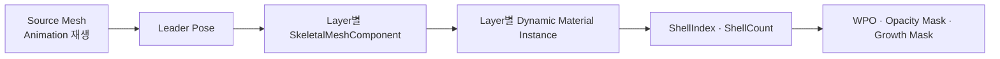
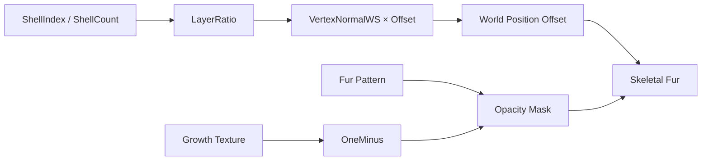

# Real-Time Fur Rendering

> **Unreal Engine 5.7에서 Shell Texturing을 Skeletal Mesh에 적용한 1인 렌더링 기술 데모**입니다.  
> Static Mesh에서 Layer 값 전달 방식을 먼저 검증한 뒤, Leader Pose와 Layer별 Material Instance를 사용해 애니메이션을 재생하는 캐릭터로 확장했습니다.

## 프로젝트 개요

| 항목 | 내용 |
| --- | --- |
| 개발 기간 | 2026.05–2026.06 |
| 개발 인원 | 1인 개발 |
| 엔진 | Unreal Engine 5.7 |
| 구현 | Blueprint / Material Graph |
| 기법 | Shell Texturing |
| 적용 대상 | Static Mesh 검증 → Skeletal Mesh 확장 |

이 데모의 목적은 Fur System을 범용화하는 것이 아니라, 다음 두 조건을 UE5 Blueprint와 Material Graph 안에서 함께 만족시키는 것이었습니다.

- 모든 Shell이 원본 캐릭터와 같은 Bone Pose를 따라갈 것
- 각 Shell이 서로 다른 `ShellIndex` 값을 Material에 전달할 것

---

## 구현 결과

현재 Skeletal Blueprint는 하나의 Source Mesh와 64개의 Shell Layer를 사용합니다.

- Source Mesh에서 Animation 재생
- 모든 Shell이 Leader Pose로 Source Mesh의 Bone Pose 공유
- Shell별 Dynamic Material Instance 생성
- `ShellIndex`와 `ShellCount`를 Layer마다 개별 전달
- Vertex Normal 방향 WPO로 Layer 확장
- Opacity Mask로 Fur 패턴 생성
- Growth Mask로 Fur 적용 부위 제한



---

## 1. Static Mesh에서 Layer 값 전달 검증

먼저 `InstancedStaticMeshComponent`에 같은 Mesh Instance를 여러 개 추가하고, `PerInstanceCustomData`로 Layer 값을 전달했습니다.

```text
Instance 생성
  -> Instance별 ShellIndex 기록
  -> Material에서 PerInstanceCustomData 조회
  -> LayerRatio 계산
  -> Vertex Normal 방향으로 위치 확장
```

이 단계에서 다음 요소를 분리해 확인했습니다.

- 같은 Geometry를 여러 Layer로 겹치는 구조
- Layer별로 다른 Scalar 값을 Material에 전달하는 경로
- WPO와 Opacity Mask가 Fur 실루엣에 미치는 영향

Static Mesh 단계의 목적은 최종 구조를 확정하는 것이 아니라, **Shell Texturing의 Layer 계산과 Material 표현을 먼저 검증하는 것**이었습니다.

---

## 2. Skeletal Mesh에서 추가된 조건

Skeletal Mesh로 확장하면서 각 Layer가 Animation Pose를 따라가야 했고, 동시에 서로 다른 Material Parameter를 유지해야 했습니다.

| 방식 | 이번 데모에서의 판단 |
| --- | --- |
| Instanced Static Mesh | Static Mesh의 Layer 값 전달 검증에 사용 |
| Instanced Skinned Mesh | 다수 캐릭터 처리보다 Layer별 Material 값 전달이 우선인 이번 구조와 맞지 않아 사용하지 않음 |
| Layer별 `SkeletalMeshComponent` | Leader Pose와 Layer별 Material Instance를 함께 사용하기 위해 선택 |

여러 캐릭터를 한 번에 그리는 Crowd Rendering이 목적이 아니라, **한 캐릭터의 동일 Pose 위에 서로 다른 Layer 값을 가진 Shell을 겹치는 것**이 목적이었습니다.

---

## 3. Leader Pose와 Layer별 Material Instance

`BP_ShellFur_Skeletal`의 Construction Script에서 `ShellCount`만큼 `SkeletalMeshComponent`를 생성합니다.

```text
SkeletalMeshComponent 생성
  -> Source Mesh에 Attach
  -> 동일 Skeletal Mesh Asset 설정
  -> Leader Pose Component 지정
  -> Collision 비활성화
  -> Shell용 Shadow 설정 적용
  -> Dynamic Material Instance 생성
  -> ShellIndex / ShellCount 설정
```

Source Mesh만 Animation을 재생하고, 각 Shell은 Leader Pose를 통해 같은 Bone Transform을 사용합니다. Material Instance는 Shell마다 별도로 생성해 Pose 공유와 Layer Parameter 전달 책임을 분리했습니다.

```text
Animation 책임     : Source Mesh
Bone Pose 공유      : Leader Pose
Layer Geometry      : SkeletalMeshComponent
Layer별 표현 값     : Dynamic Material Instance
```

---

## 4. Material Graph

### Layer Ratio

각 Shell이 Base Surface에서 얼마나 떨어질지 계산합니다.

```text
LayerRatio = ShellIndex / ShellCount
```

### World Position Offset

LayerRatio가 클수록 Vertex Normal 방향으로 더 멀리 이동합니다.

```text
WPO = VertexNormalWS × LayerRatio × OffsetScale
```

### Fur Pattern과 Growth Mask

Fur Pattern Texture를 Opacity Mask에 사용해 Layer 사이에 털 가닥 형태의 빈 영역을 만들고, Growth Texture로 Fur가 적용될 부위를 제한합니다.

```text
GrowthMask = 1 - FurGrowthTexture.R
FinalOpacity = FurPattern × GrowthMask
```

| 입력 | Material에서의 역할 | 화면 결과 |
| --- | --- | --- |
| `ShellIndex` · `ShellCount` | LayerRatio 계산 | Layer별 확장 거리 결정 |
| `VertexNormalWS` | WPO 방향 | Mesh 표면 바깥쪽으로 Shell 확장 |
| `FurPattern` | Opacity Mask | Fur 가닥 분포와 밀도 표현 |
| `FurGrowthTexture` | Growth Mask | Fur가 자라는 부위 제한 |



---

## 5. Shell Count와 렌더링 비용

Shell 수가 늘어나면 Layer 간격이 촘촘해져 Fur 실루엣은 연속적으로 보이지만, 구조적으로 다음 비용도 함께 증가합니다.

| 항목 | Shell Count 증가 시 변화 |
| --- | --- |
| `SkeletalMeshComponent` | Layer 수만큼 Component 증가 |
| Material 제출 | Shell별 Dynamic Material Instance 제출 증가 |
| Masked Overdraw | 같은 화면 영역에 겹쳐 그리는 Pixel 증가 |
| 관리 비용 | Construction과 Component 상태 관리 대상 증가 |

현재 Skeletal Blueprint의 기본값은 **64 Shell**입니다. 이 값은 대표 결과를 만들기 위해 사용한 설정이며, 특정 Hardware에서의 최적값을 의미하지 않습니다.

```text
Rendering Cost는 대체로
Shell Count × Material Slot × Render Pass
증가 방향의 영향을 받습니다.
```

정확한 Frame Time·GPU Time은 별도로 측정하지 않았으므로 Layer별 성능 수치나 권장 개수를 주장하지 않습니다.

---

## 구현 Asset

| Asset | 경로·이름 |
| --- | --- |
| Demo Map | `/Game/ShellTexture/Demoroom/SandboxMap` |
| Skeletal Fur Blueprint | `/Game/ShellTexture/BP_ShellFur_Skeletal` |
| Skeletal Mesh | `SK_GermanShepherd_01` |
| Material | `M_ShellTexturing_Skeletal` |

## 실행

```text
1. Unreal Engine 5.7에서 FurRendering.uproject 열기
2. /Game/ShellTexture/Demoroom/SandboxMap 열기
3. BP_ShellFur_Skeletal의 ShellCount와 Material Parameter 확인
4. Play 또는 Editor Viewport에서 Animation과 Shell 동기화 확인
```

외부 Skeletal Mesh와 Texture의 재배포·사용 범위는 각 원본 Asset License를 따릅니다.

---

## 적용 범위와 한계

- Blueprint와 Material Graph로 구현한 단일 캐릭터 대상 기술 데모입니다.
- Frame Time과 GPU Time을 측정하지 않았습니다.
- 다수 캐릭터 동시 적용 성능을 검증하지 않았습니다.
- Shell 수만큼 `SkeletalMeshComponent`와 Material 제출이 증가합니다.
- Masked Material을 여러 겹 렌더링하므로 Overdraw 비용이 증가합니다.
- 상용 Fur System, Strand 기반 Hair, 엔진 레벨 Renderer 최적화를 대체하는 구조가 아닙니다.

이 프로젝트는 렌더링 기능을 과장하기보다, **Static Mesh에서 검증한 표현 기법을 Skeletal Mesh의 Pose 공유 구조에 맞게 확장하고, 품질과 비용의 경계를 확인한 과정**을 보여주는 데 목적이 있습니다.

## 라이선스

Copyright (c) 2026 Real-Time Fur Rendering. All rights reserved.
